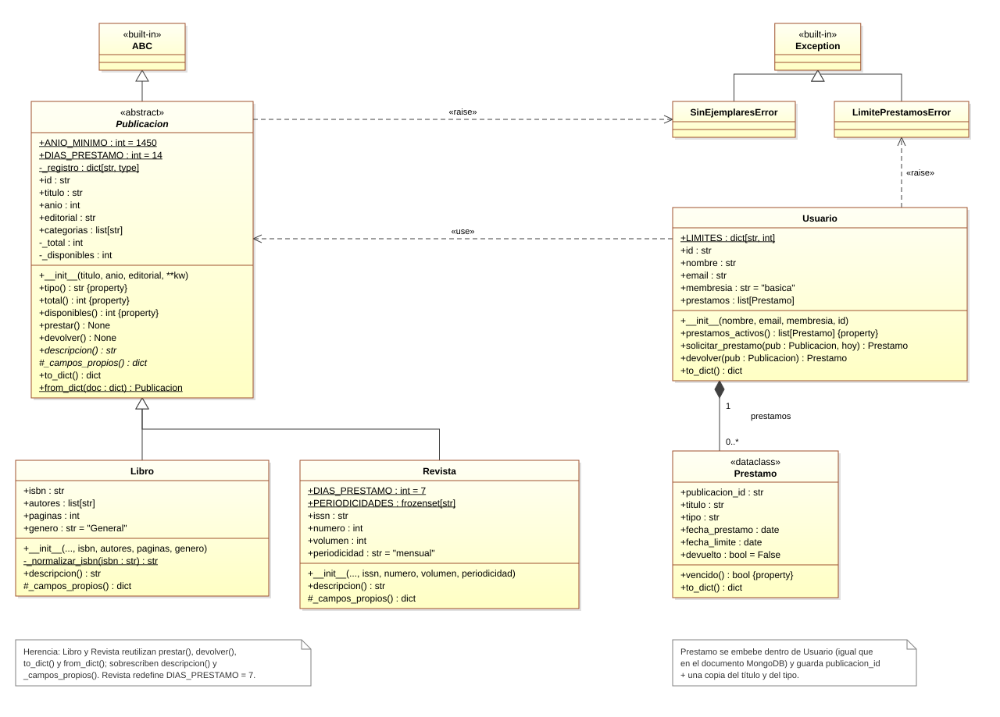

# Biblioteca digital: herencia UML en Python

Ejercicio práctico asistido con IA. Modela una biblioteca digital con una jerarquía de clases donde `Libro` y `Revista` heredan de la clase base abstracta `Publicacion`. Los objetos se serializan a documentos con estructura de MongoDB (orientada a documentos, no relacional).

## Diagrama de clases



## Estructura

```text
├── main.py                     # Demostración
├── diagrama_clases_python.svg  # Diagrama UML (estilo Visual Paradigm)
└── biblioteca/
    ├── publicacion.py          # Clase base abstracta (ABC)
    ├── libro.py                # Subclase Libro
    ├── revista.py              # Subclase Revista
    └── usuario.py              # Usuario y Prestamo (embebido)
```

## Conceptos que muestra

- **Herencia:** `Libro` y `Revista` reutilizan `prestar()`, `devolver()`, `to_dict()` y `from_dict()` de `Publicacion`.
- **Polimorfismo:** cada subclase sobrescribe `descripcion()`. `Revista` también cambia `DIAS_PRESTAMO` a 7 días.
- **Clase abstracta:** `Publicacion` no se puede instanciar directamente.
- **Modelo de documentos:** los préstamos van embebidos dentro del usuario, igual que en un documento MongoDB.

## Ejecución

Requiere Python 3.10 o superior, sin dependencias externas.

```bash
python main.py
```
